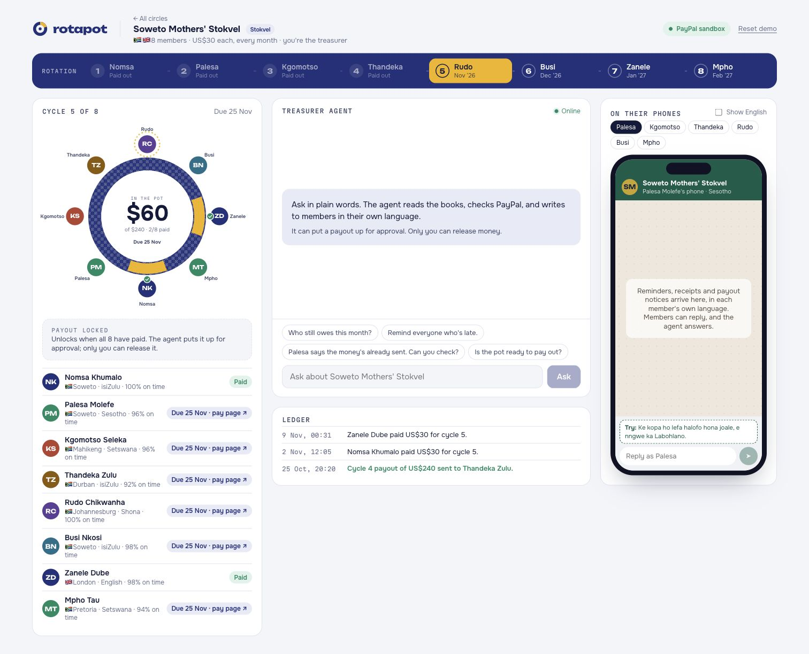
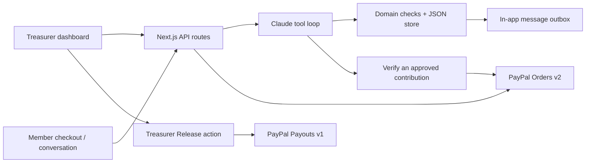

<p align="center"></p>

<p align="center">
  <a href="https://rotapot.simakk.co.za"><strong>Try the live demo</strong></a> ·
  <a href="https://youtu.be/6AdlBTQAcvI"><strong>Watch the film</strong></a> ·
  <a href="https://devpost.com/software/rotapot"><strong>Devpost</strong></a> ·
  <a href="https://github.com/simandebvu/rotapot/releases">Releases</a>
</p>
<p align="center">
  <a href="https://github.com/simandebvu/rotapot/actions/workflows/verify.yml"></a>
  <a href="https://github.com/simandebvu/rotapot/releases"></a>
  <a href="LICENSE"></a>
  
</p>

## The circle already has trust. Give its treasurer some time back.

Stokvels in South Africa. Mukando and rounds in Zimbabwe. Savings circles across the diaspora. Each member contributes, and the pot goes to a different member in turn.

The admin usually falls to one person: chasing payments, checking who has paid and keeping everyone informed. **Rotapot is an AI treasurer’s assistant for that work.** Claude reads the books and handles the conversation; PayPal handles contributions and payouts. The treasurer decides when to release the pot.

Built for the **PayPal AI Hackathon 2026** by [Shingirayi Innocent Mandebvu](https://github.com/simandebvu).

[](https://rotapot.simakk.co.za)

*An actual screenshot of the sandbox demo. The indigo ring draws on shweshwe; each gold segment makes a contribution visible.*

## What you can try

| Experience | What happens |
| --- | --- |
| **One briefing, three circles** | The agent reads each circle, follows its reminder instructions and proposes ready payouts. Its tool calls stream to the dashboard. |
| **A personal pay link** | Each member has a checkout page using PayPal Orders v2 and the JavaScript SDK. Approved instalments use the same link. |
| **A conversation, in their language** | Shona, Ndebele, isiZulu, Sesotho, Setswana and English. Members can reply, ask for time or ask the agent to check a payment. |
| **A plan with a person behind it** | The agent reads payment history and proposes instalments. The treasurer approves or declines. |
| **A pot released by the treasurer** | The agent proposes; the Release action invokes PayPal Payouts v1. The next cycle then opens. |
| **A visible payment record** | The trust passport shows contributions, on-time rate and streaks across circles. Historical demo records are seeded. |

> **Prototype boundary:** sandbox payments only. Messages stay in an in-app outbox, not real WhatsApp. Sign-in is a demo convenience, not production authentication. Do not use this build for real funds or personal financial data.

## Take the two-minute tour

1. [Open Rotapot](https://rotapot.simakk.co.za) and use the pre-filled demo sign-in.
2. Let the briefing run. Inspect the actions across Ubuntu, Leicester and Soweto.
3. Open **Ubuntu Circle**. Try a member’s suggested reply asking to split a contribution, then review the proposed plan as the treasurer.
4. Open **Leicester Diaspora Round** to see a ready pot and the sandbox payout flow.
5. Open any member’s **trust passport** to see their contribution history.

The hosted demo is shared. **Reset demo** restores its starting state for everyone. See the [full demo guide](docs/DEMO.md) for checkout instructions and expected outcomes.

## Run locally

Use Node.js 22 and npm. The repository includes a lockfile.

```bash
git clone https://github.com/simandebvu/rotapot.git
cd rotapot
npm ci
cp .env.example .env.local
npm run dev
```

Open **http://localhost:3000**. Add your own credentials to `.env.local`:

| Variable | Purpose |
| --- | --- |
| `ANTHROPIC_API_KEY` | Enables the Claude treasurer agent. Without it, the UI can run but AI actions are unavailable. |
| `AGENT_MODEL` | Optional model override; use a model available to your account. |
| `ANTHROPIC_BASE_URL` | Optional Anthropic-compatible gateway endpoint. |
| `PAYPAL_CLIENT_ID` + `PAYPAL_CLIENT_SECRET` | Enables PayPal **sandbox** checkout and payouts. Leave both blank for mock payments. |
| `PAYPAL_PAYOUT_RECEIVER_OVERRIDE` | Optional sandbox personal-account email for receiving test payouts. |

Never commit `.env.local`. Demo state is stored in `data/db.json` and is generated automatically. Run one application process with a writable filesystem. Building fetches Google Fonts, so the build needs network access.

```bash
npm run typecheck
npm run build
npm start
```

## How the pieces fit



The agent has **nine tools**, including payment verification, reminder delivery to the outbox, payment-plan proposals and payout proposals. It has **no payout-release tool**. Verification can capture a contribution the member already approved. Read the [architecture and authority boundaries](docs/ARCHITECTURE.md).

## Project guide

| Resource | Start here for |
| --- | --- |
| [Demo guide](docs/DEMO.md) | Judge walkthrough, sandbox checkout and reset behaviour |
| [Architecture](docs/ARCHITECTURE.md) | Agent tools, payment flow, storage and limitations |
| [Roadmap](docs/ROADMAP.md) | What ships today and what needs to come next |
| [Changelog](CHANGELOG.md) | Versioned release history |
| [Contributing](CONTRIBUTING.md) | Setup, checks and focused contributions |
| [Security](SECURITY.md) | Reporting concerns and understanding the demo boundary |

## What comes next

Real WhatsApp delivery, native-speaker review, durable storage and production identity controls come before any real-money pilot. Local payment rails and a consent-based portable payment record are longer-term directions. The [roadmap](docs/ROADMAP.md) separates these plans from features available now.

## License

[MIT](LICENSE). This project is an independent hackathon prototype; it is not an official PayPal or Anthropic product.
