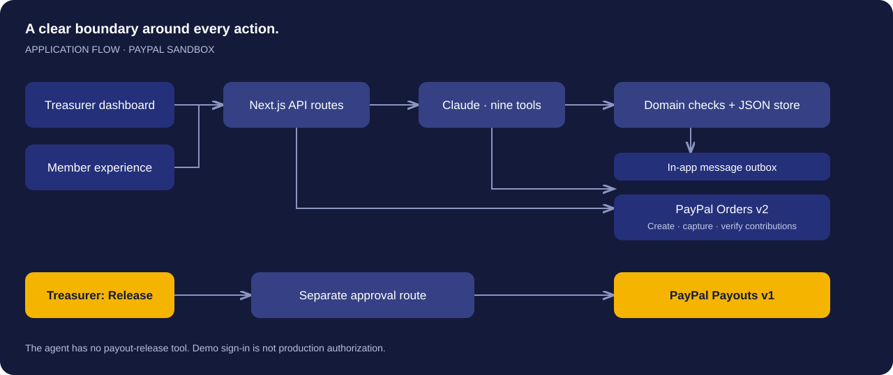

<p align="center"></p>

<p align="center">
  <a href="https://rotapot.simakk.co.za"><strong>Try the live demo</strong></a> ·
  <a href="https://youtu.be/6AdlBTQAcvI"><strong>Watch the film</strong></a> ·
  <a href="https://devpost.com/software/rotapot"><strong>Devpost</strong></a> ·
  <a href="https://github.com/simandebvu/rotapot/releases">Releases</a>
</p>
<p align="center">
  <a href="https://github.com/simandebvu/rotapot/actions/workflows/verify.yml"></a>
  <a href="https://github.com/simandebvu/rotapot/releases"></a>
  <a href="LICENSE"></a>
  
</p>

## The circle already has trust. Give its treasurer some time back.

Stokvels in South Africa. Mukando and rounds in Zimbabwe. Savings circles across the diaspora. Each member contributes, and the pot goes to a different member in turn.

The admin usually falls to one person: chasing payments, checking who has paid and keeping everyone informed. **Rotapot is an AI treasurer’s assistant for that work.** Claude reads the books and handles the conversation; PayPal handles contributions and payouts. The treasurer decides when to release the pot.

Built for the **PayPal AI Hackathon 2026** by [Shingirayi Innocent Mandebvu](https://github.com/simandebvu).

[](https://rotapot.simakk.co.za)

*An actual screenshot of the sandbox demo. The indigo ring draws on shweshwe; each gold segment makes a contribution visible.*

## What you can try

| Experience | What happens |
| --- | --- |
| **One briefing, three circles** | The agent reads each circle, follows its reminder instructions and proposes ready payouts. Its tool calls stream to the dashboard. |
| **A personal pay link** | Each member has a checkout page using PayPal Orders v2 and the JavaScript SDK. Approved instalments use the same link. |
| **A conversation, in their language** | Shona, Ndebele, isiZulu, Sesotho, Setswana and English. Members can reply, ask for time or ask the agent to check a payment. |
| **A plan with a person behind it** | The agent reads payment history and proposes instalments. The treasurer approves or declines. |
| **A pot released by the treasurer** | The agent proposes; the Release action invokes PayPal Payouts v1. The next cycle then opens. |
| **A visible payment record** | The trust passport shows contributions, on-time rate and streaks across circles. Historical demo records are seeded. |

> **Prototype boundary:** sandbox payments only. Messages stay in an in-app outbox, not real WhatsApp. Accounts use verified email sign-in and password resets through Resend. You can create your own circle or explore optional sample circles. Do not use this build for real funds or personal financial data.

## Take the two-minute tour

1. [Open Rotapot](https://rotapot.simakk.co.za) and create an account, verify your email, then sign in.
2. Let the briefing run. Inspect the actions across Ubuntu, Leicester and Soweto.
3. Open **Ubuntu Circle**. Try a member’s suggested reply asking to split a contribution, then review the proposed plan as the treasurer.
4. Open **Leicester Diaspora Round** to see a ready pot and the sandbox payout flow.
5. Open any member’s **trust passport** to see their contribution history.

**Explore sample circles** adds the three showcase circles. Refreshing samples replaces only those examples; your own circles and joined memberships remain intact. See the [full demo guide](docs/DEMO.md) for checkout instructions and expected outcomes.

## Run locally

Use Node.js 22 and npm. The repository includes a lockfile.

```bash
git clone https://github.com/simandebvu/rotapot.git
cd rotapot
npm ci
cp .env.example .env.local
npm run dev
```

Open **http://localhost:3000**. Add your own credentials to `.env.local`:

| Variable | Purpose |
| --- | --- |
| `BETTER_AUTH_SECRET` | Required random secret, at least 32 characters. Generate with `openssl rand -base64 48`; keep stable across restarts. |
| `BETTER_AUTH_URL` | Exact application origin, e.g. `http://localhost:3000` locally or your HTTPS production URL. |
| `RESEND_API_KEY` | Required for email verification and password reset delivery. |
| `RESEND_FROM` | Verified Resend sender, e.g. `Rotapot <info@simakk.co.za>`. |
| `AUTH_TRUSTED_IP_HEADER` | Optional proxy-overwritten client IP header for per-client rate limits. Leave unset unless the proxy guarantees it. |
| `ANTHROPIC_API_KEY` | Enables the Claude treasurer agent. Without it, the UI can run but AI actions are unavailable. |
| `AGENT_MODEL` | Optional model override; use a model available to your account. |
| `ANTHROPIC_BASE_URL` | Optional Anthropic-compatible gateway endpoint. |
| `PAYPAL_CLIENT_ID` + `PAYPAL_CLIENT_SECRET` | Enables PayPal **sandbox** checkout and payouts. Leave both blank for mock payments. |
| `PAYPAL_PAYOUT_RECEIVER_OVERRIDE` | Optional sandbox personal-account email for receiving test payouts. |

Never commit `.env.local`. Accounts and sessions are stored in `data/auth.sqlite`; each account’s circle and membership data lives in `data/accounts/`. Tables are created automatically; new accounts start with no circles. The legacy `data/db.json` is left untouched and is no longer served. Run one application process with a writable filesystem. Building fetches Google Fonts, so the build needs network access.

```bash
npm run typecheck
npm test
npm run build
npm start
```

## Account setup

Configure all four auth/email variables above before creating an account. Verification links last one hour; password reset links last 30 minutes and can be used once. A password reset revokes existing sessions. Passwords require 12–128 characters. Sign-out revokes the server session; the old demo cookie grants no access.

Use a persistent disk for `data/` and back up both account SQLite data and circle files. Optional `AUTH_DB_PATH` and `ACCOUNT_DATA_DIR` relocate these stores. The auth schema is migrated on first use. Auth requests are rate limited in SQLite; without a trusted client IP header, requests share a conservative per-endpoint limit. Production requires HTTPS and the exact public `BETTER_AUTH_URL`; forwarding arbitrary client-supplied IP headers is unsafe.

Signed member payment links work without login, expire after 30 days, and only authorize the named contribution. Refreshing sample circles invalidates their old links; links for user-created circles are preserved. Unsigned payment URLs require the treasurer’s session. Dashboard and API routes verify the session server-side, and mutations check the request origin. New accounts start empty. Treasurers own their circles; invited members can only view their own membership and contribute. Invitations require the intended verified email account.

`npm test` exercises the full create → invite → verify → accept → launch → contribute → payout journey, including failed delivery, duplicate emails, edited/expired invitations, member access boundaries and sample-data isolation. It also exercises verification, wrong passwords, forged cookies, API protection, account isolation, signed payment access, logout, reset expiry/reuse, session revocation, and reset rate limiting with mocked email delivery. It sends no real email.

## Start a real circle in the sandbox

1. **Sign up and verify your email.** Sign in, then choose **Start my first circle**.
2. **Give it a name.** Choose Stokvel, Mukando, Diaspora round or Savings circle, and describe your shared goal.
3. **Set the promise.** Pick a monthly USD contribution, the first due date and any extra rule. This version supports 2–20 members and one complete monthly rotation.
4. **Pull up chairs.** Include yourself, add names/emails/cities/languages, set your own PayPal sandbox payout email, and use the arrows to arrange the payout order. Drafts are saved in the current browser tab while you work.
5. **Review and create.** Nothing is emailed until you choose **Send pending invitations**. Invitations use Resend, expire in seven days, and can be resent. Delivery failures remain visible; private copyable links are also available.
6. **Members review and accept.** Each invitee creates or signs into the account matching their invitation email, verifies it, chooses their sandbox payout address and agrees to the contribution, rotation and rules. Signup/verification preserves the invitation destination. Their personal page then appears under **Your seat at the table**.
7. **Launch together.** Once every member has joined, launch to generate monthly contribution cycles and open member checkout. The dates clamp to the last day in shorter months. Editing before launch renews invitations and requires everyone to accept again; launching locks the people, terms and rotation.
8. **Collect and release.** Members contribute from their personal page. A full pot becomes ready for the treasurer’s approval even without an AI call. Release advances the rotation; actual new-member contributions build the trust passport.

For a quick judge walkthrough with one inbox, use **Explore sample circles** after signup. For the complete invitation journey, use two email addresses/accounts you control. In a configured PayPal environment, use sandbox personal accounts for payments and payouts. Without PayPal credentials, local mock payments are available. AI reminders remain in the in-app outbox; email invitations are real transactional emails. This is still a sandbox, not a live-money service.

## How the pieces fit



The agent has **nine tools**, including payment verification, reminder delivery to the outbox, payment-plan proposals and payout proposals. It has **no payout-release tool**. Verification can capture a contribution the member already approved. Read the [architecture and authority boundaries](docs/ARCHITECTURE.md).

## Project guide

| Resource | Start here for |
| --- | --- |
| [Demo guide](docs/DEMO.md) | Judge walkthrough, sandbox checkout and reset behaviour |
| [Architecture](docs/ARCHITECTURE.md) | Agent tools, payment flow, storage and limitations |
| [Roadmap](docs/ROADMAP.md) | What ships today and what needs to come next |
| [Changelog](CHANGELOG.md) | Versioned release history |
| [Contributing](CONTRIBUTING.md) | Setup, checks and focused contributions |
| [Security](SECURITY.md) | Reporting concerns and understanding the demo boundary |

## What comes next

Real WhatsApp delivery, native-speaker review, transactional circle storage and expanded member roles come before any real-money pilot. Local payment rails and a consent-based portable payment record are longer-term directions. The [roadmap](docs/ROADMAP.md) separates these plans from features available now.

## License

[MIT](LICENSE). This project is an independent hackathon prototype; it is not an official PayPal or Anthropic product.
